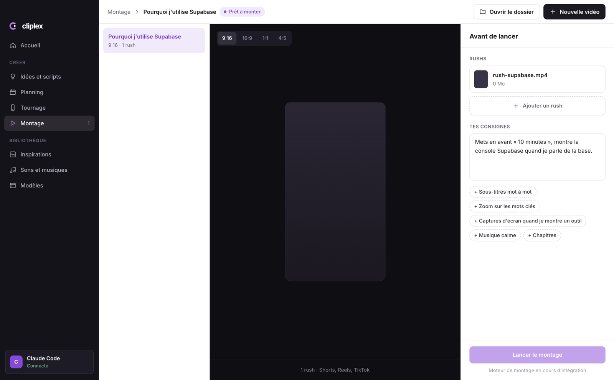

# Cliplex

**Tu tournes, ta vidéo est montée.**

Cliplex est un studio vidéo qui tourne sur ton ordinateur. Tu prépares ton idée, tu tournes avec le prompteur, tu déposes ton rush, et l'IA fait le montage : sous-titres mot à mot, animations, sons, musique. Pour les Shorts, Reels et TikTok, les vidéos YouTube et les formations.

Gratuit et open source. Tu branches simplement ton propre compte Claude.



## Pourquoi « Cliplex »

Clip Express : ta vidéo montée en quelques minutes. Et un lexique : Cliplex apprend le style de tes vidéos préférées pour monter les tiennes de la même façon.

## Principes

- **Tout reste sur ton Mac, dans un seul dossier.** Outils, rushs, montages, inspirations et style vont dans ton dossier Cliplex. Supprime-le avec l'app, et il ne reste rien.
- **Transparence totale.** Chaque outil installé est montré, expliqué, avec la commande exacte lancée. Rien n'est caché.
- **Ton compte, tes règles.** Cliplex lance Claude Code avec ton propre abonnement. Il ne voit jamais tes identifiants.
- **Ton style, pas le nôtre.** Tu montres à Claude les vidéos que tu aimes ; il en tire ton style et l'applique à chaque montage.
- **Des fichiers normaux.** Un projet = un dossier lisible que tu peux ouvrir, copier, sauvegarder.

## État

Version 0.1, en développement actif. macOS d'abord, Windows et Linux ensuite.

| Fonction | État |
| --- | --- |
| Premier lancement guidé (besoins, objectifs, dossier, installation, Claude, inspirations) | Fait |
| Projets vidéo : genre, format, rushs, consignes | Fait |
| Brouillon à valider, retouches, export 4K ou 1080p | Fait |
| Utilisation sans l'app, depuis Claude Code (`./cliplex`) | Fait |
| Moteur de montage automatique (formation, YouTube, courts, pubs) | Fait, en amélioration |
| Inspirations (vidéos, images, liens YouTube) et style appris | Fait |
| Idées, scripts et planning | À venir |
| Prompteur sur téléphone, décor de tournage | À venir |
| Banque de sons libres de droits | À venir |

## Utiliser avec Claude Code, sans l'app

Tu peux aussi tout faire depuis Claude Code, sans lancer l'app :

```bash
git clone https://github.com/mariusdjen/cliplex.git
cd cliplex
claude
```

Dis bonjour, ou tape `/setup`. Claude t'explique ce qu'il faut, installe les outils (avec ton accord), te demande tes vidéos d'inspiration (fichiers ou liens YouTube), en tire ton style, puis monte tes vidéos. Tu regardes un brouillon, tu demandes des retouches, et rien n'est exporté (en 4K ou en 1080p) avant que tu le valides.

Le détail de chaque étape : [docs/comment-ca-marche.md](docs/comment-ca-marche.md).

Tout va dans le dossier `espace/` du dépôt (ou dans celui de l'app si tu l'utilises aussi : ce sont les mêmes fichiers). Le script `./cliplex` fait chaque étape ; lance-le sans argument pour voir ses commandes.

## Installer pour développer

Prérequis : macOS, Node.js 20 ou plus.

```bash
git clone https://github.com/mariusdjen/cliplex.git
cd cliplex
npm install
npm run dev
```

Les outils de montage (ffmpeg, Node, Python et whisper, Remotion, Claude Code si besoin) s'installent depuis l'app au premier lancement, dans le dossier Cliplex, ou à la main : voir [docs/installation-manuelle.md](docs/installation-manuelle.md).

## Structure

```
src/main/        processus principal Electron : outils, projets, Claude
src/preload/     pont sécurisé entre l'interface et le système
src/renderer/    interface React (Tailwind)
src/shared/      types communs
```

## Contribuer

Les contributions sont les bienvenues : voir [CONTRIBUTING.md](CONTRIBUTING.md).

## Licence

[Apache 2.0](LICENSE). Le nom et le logo Cliplex ne sont pas couverts par la licence du code.

Le moteur d'animation s'appuiera sur [Remotion](https://www.remotion.dev), gratuit pour les particuliers et les petites structures ; les entreprises de plus de trois personnes ont besoin d'une licence Remotion.
